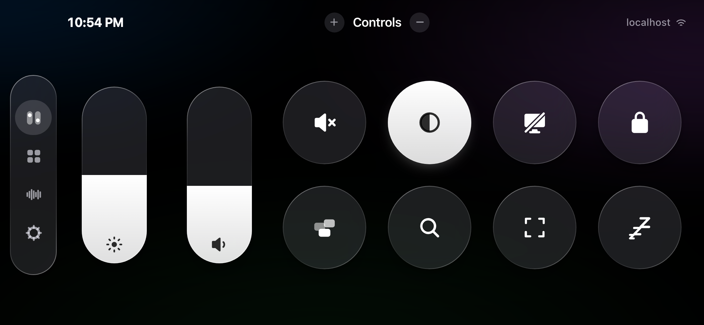
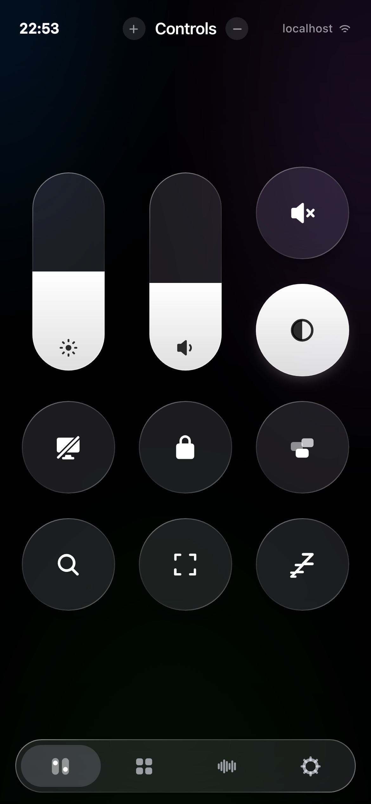
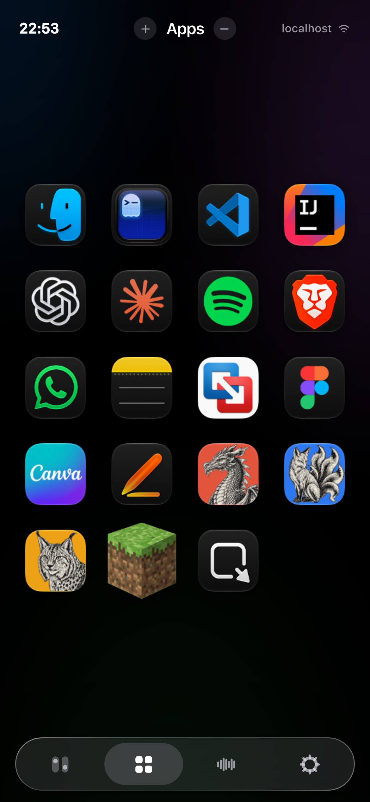
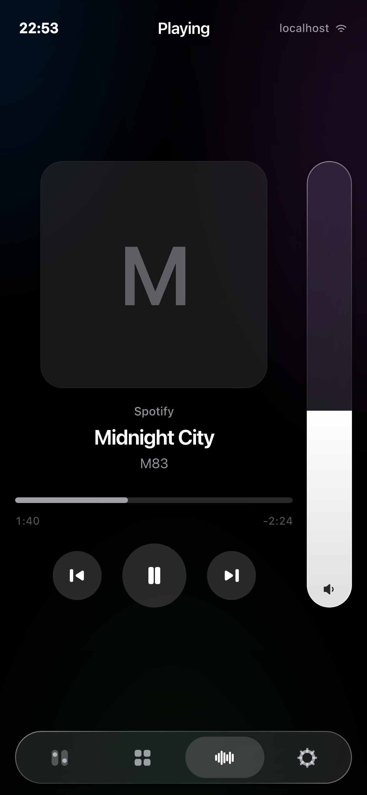
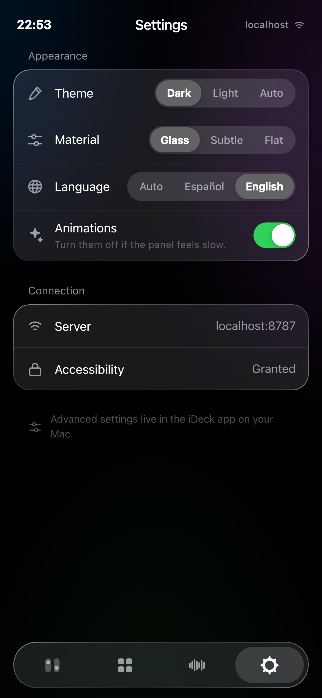
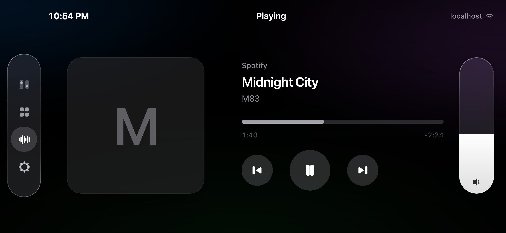
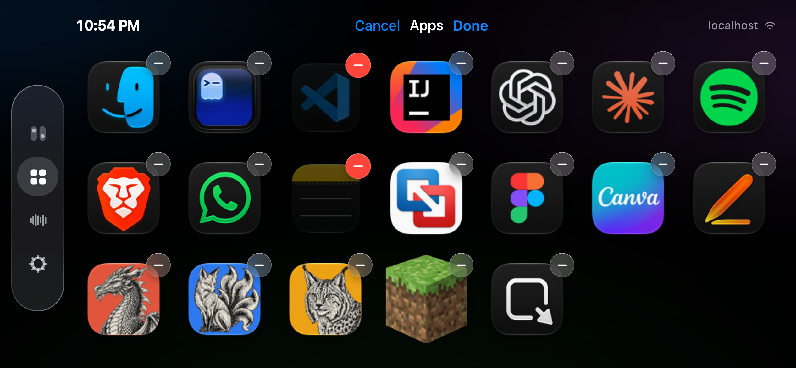
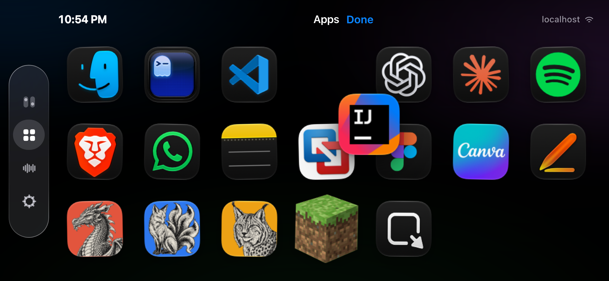
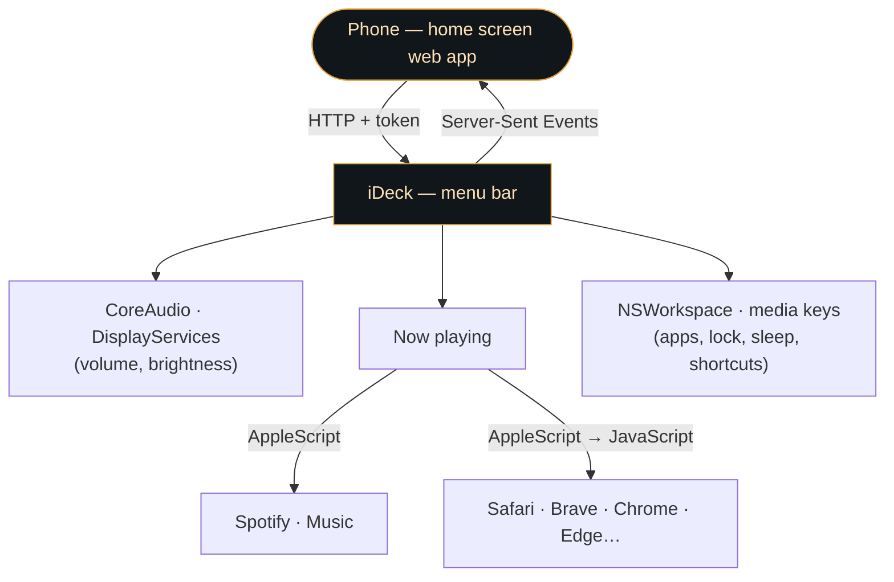

<p align="center">
  
</p>

<p align="center">
  
  
  
  
</p>

A Stream Deck for your Mac that lives on your phone. A menu bar app on the
Mac serves a panel over your local network; you scan a QR code, add it to
your home screen, and your phone becomes the Mac's control center: volume,
brightness, what's playing, your apps and the system buttons, all one tap
away.

No dependencies: Swift on the Mac, plain HTML, CSS and JavaScript on the
phone. Nothing to install on the phone either.

<p align="center">
  
</p>

## Index

- [Why](#why)
- [Installation](#installation)
- [First launch](#first-launch)
- [The panel](#the-panel)
- [Adding, removing and rearranging](#adding-removing-and-rearranging)
- [Permissions (first time only)](#permissions-first-time-only)
- [Settings](#settings)
- [How it fits together](#how-it-fits-together)
- [Known limitations](#known-limitations)
- [License](#license)

## Why

The keys you reach for all day — volume, play/pause, brightness, lock — are
either buried in the menu bar or need a keyboard you're not sitting at. A
Stream Deck fixes that, but it's another device on the desk. Your phone is
already there.

- A **Control Center for the Mac**: brightness and volume sliders, mute,
  dark mode, display off, lock, sleep, Mission Control, Spotlight and
  screenshots.
- **What's playing**, from Spotify, Music or any browser tab (YouTube,
  Netflix…), with its artwork, a draggable progress bar and ±10 s.
- **Your apps** with their real Mac icons, one tap to open.
- **Live**: the Mac pushes every change, so a pause done on the keyboard or
  the volume moved from the Mac shows up on the phone instantly.
- Full screen from the **home screen**, in portrait or landscape, with no
  browser bars.

## Installation

```sh
git clone https://github.com/alexcalatyd/iDeck.git
cd iDeck
./build.sh --install
open -a iDeck
```

That compiles it, signs it and installs it straight into `/Applications`.
It only needs the Xcode command line tools (`xcode-select --install`) and
macOS 13 or later.

> [!TIP]
> `build.sh` signs with your **Apple Development** certificate if there's
> one in the keychain. That keeps the Accessibility permission across
> rebuilds. Without one it falls back to an ad-hoc signature, which works
> just the same, but macOS asks for the permission again after every build.

## First launch

iDeck has no Dock icon and no main window — look for its **grid icon in the
menu bar**. The first time, it opens on its own with a QR code.

1. Point your phone's camera at the QR and open the link. The access token
   travels inside it, so there's nothing to type.
2. In Safari, tap **Share → Add to Home Screen**. The panel asks you to do
   this the first time it's opened in a browser tab: from the icon it runs
   full screen, with no browser bars, in portrait and in landscape.

The link uses the Mac's `.local` name, so it keeps working when the IP
changes. For a short, stable address:

```sh
sudo scutil --set LocalHostName ideck   # → http://ideck.local:8787
```

To show the QR again, click the menu bar icon, or launch it with
`open -a iDeck --args --pair`.

## The panel

Four screens, each with one job, and a dock to move between them: at the
bottom in portrait, down the left side in landscape. **Nothing ever
scrolls**: whatever doesn't fit moves to a next page, one swipe up or down
away.

<p align="center">
  
  
  
  
</p>

| Screen | What's in it |
|---|---|
| **Controls** | Brightness and volume as tall Control Center pills, and round buttons for everything else. The grid sizes itself to fill the screen. A button that's on fills in white, like the iPhone's flashlight: mute shows a speaker with a cross and turns white while the Mac is muted. |
| **Apps** | Your apps with their real Mac icons, on a fixed grid: 4 × 6 in portrait, 7 × 3 in landscape. |
| **Playing** | Artwork, title, a progress bar you can drag, transport and a volume pill. Previous/next for Spotify and Music, ±10 s for a video in the browser. |
| **Settings** | Theme, material (glass, subtle, flat), language, animations and the connection status. |

What happens on the Mac but can't be seen from the phone — locking it,
turning the display off, opening an app, losing the connection — is
confirmed in a small **island** at the top that closes by itself. The dock
has a glass lens that slides to the current tab; drag your finger along the
dock to move between screens without lifting it.

<p align="center">
  
</p>

## Adding, removing and rearranging

Controls and Apps both carry a small **+** to the left of the title and a
**−** to the right.

- **+** opens a picker. On Apps it lists every app installed on the Mac,
  with a search field on top; on Controls, the buttons you've removed. Tap
  as many as you like, then **Done**, or drag the sheet down to close it.
- **−** first explains how it works, then puts a glass **−** badge on every
  icon. Tap the ones you want gone (the badge turns red) and they're removed
  together when you tap **Done**. **Cancel** removes nothing. Selecting
  first and confirming after means a slightly-off tap on a small badge never
  costs you an app.

<p align="center">
  
</p>

To **rearrange**, do what you'd do on the iPhone: **press and hold** any
icon or control for half a second. Everything starts to jiggle and the one
under your finger lifts and follows it; the rest slide out of the way.
Once you're in, drag any other icon straight away, without waiting. Hold it
against the top or bottom edge to move it to another page. **Done** saves
the order on the Mac, so every paired phone sees the same layout.

<p align="center">
  
</p>

Sliders move too, as a two-cell piece, like a widget. Holding a slider
still never touches the level: it only moves once your finger moves, or on
release for a tap.

## Permissions (first time only)

| Feature | Needs |
|---|---|
| Volume, mute, brightness | nothing (CoreAudio, DisplayServices) |
| Open apps, dark mode, display off | nothing |
| Lock, sleep, restart, shut down | nothing |
| What's playing in Spotify or Music | **Automation** (macOS asks the first time) |
| What's playing in a browser | **Automation**, plus *Allow JavaScript from Apple Events* in the browser |
| Mission Control, Spotlight, screenshot | **Accessibility** |
| Play/pause in a browser | **Accessibility** (it sends the hardware media key) |

For browsers, turn on **View → Developer → Allow JavaScript from Apple
Events** (in Safari it's under the **Develop** menu). Works with Safari,
Brave, Chrome, Edge, Vivaldi, Arc and Chromium. If it's off, iDeck says so in
Settings instead of leaving an unexplained blank.

If the Accessibility permission ever gets stuck:

```sh
tccutil reset Accessibility io.github.alexcalatyd.ideck
```

## Settings

Two places, on purpose:

- **On the phone** — what makes sense to change in your hand: theme,
  material, language, animations, and the + / − / rearranging above.
- **On the Mac** (menu bar icon → Settings) — port, access token (and
  regenerating it, which unpairs every phone), which controls exist at all,
  and the app list.

Everything is saved on the Mac, in
`~/Library/Application Support/iDeck/config.json`, so a newly paired phone
inherits the same panel instead of starting from scratch. Delete the file
and it regenerates, picking a starting set of apps from what's installed.

## How it fits together



- `Sources/iDeck/` — the Mac app: menu bar and QR popover, a minimal HTTP
  server, the API, and the system controls.
- `Sources/iDeck/Web/` — the panel: `index.html` (shell and icon set),
  `style.css`, `app.js` (state, grid, gestures) and `i18n.js` (Spanish and
  English).
- `build.sh` — builds `dist/iDeck.app`; `--install` copies it to
  `/Applications`.
- `Tools/make-icon.swift` — renders the Mac app icon from the panel's
  `icon.svg`, so both share the same icon.

<details>
<summary><b>Why not MediaRemote</b></summary>
<br>

The obvious source for "now playing" is `MediaRemote`, the private framework
behind the system's Now Playing widget. Since macOS 15.4 it's gated behind
an entitlement: the calls still succeed, but any app that isn't Apple's gets
an empty dictionary back. So iDeck asks source by source: Spotify and Music
through their AppleScript dictionaries, and browsers by running JavaScript
in the playing tab, which reads `navigator.mediaSession` and the `<video>`
element.

</details>

<details>
<summary><b>Why Netflix gets its own seek</b></summary>
<br>

For most sites, seeking just sets `currentTime` on the `<video>`. Netflix
detects that, stops playback and shows error M7375. It has to go through
Netflix's own player instead — and that object isn't reachable from
AppleScript, because Chromium runs AppleScript's JavaScript in an isolated
world. So iDeck injects a small `<script>` into the page, which runs in the
page's own world and calls the player's `seek()`.

</details>

<details>
<summary><b>Why the volume doesn't bounce</b></summary>
<br>

AppleScript's `set volume` quantizes to the hardware's steps, so the value
read back wasn't the one the phone sent and the slider jumped backwards.
Volume goes through CoreAudio instead (`VirtualMainVolume`), which is a
float and reads back exactly what was written. On top of that, every
control the user might be touching reconciles: it ignores the server's value
while the finger is on it and until the Mac confirms what was sent.

</details>

<details>
<summary><b>API</b></summary>
<br>

```
GET  /api/state?t=TOKEN      → volume, brightness, track, apps, controls, system
GET  /api/events?t=TOKEN     → SSE: the same state, pushed on every change
POST /api/action?t=TOKEN     → {"id": "volume.set", "value": 40}
GET  /api/catalog?t=TOKEN    → apps installed on the Mac (for the + picker)
GET  /api/artwork?k=KEY      → current artwork
GET  /api/appicon?p=PATH     → an app's icon
```

Actions: `volume.set`, `volume.mute`, `brightness.set`, `brightness.up`,
`brightness.down`, `media.playpause`, `media.next`, `media.previous`,
`media.seek` (relative seconds), `media.position` (absolute second),
`appearance.toggle`, `display.sleep`, `system.lock`, `system.sleep`,
`system.restart`, `system.shutdown`, `shortcut.missionControl`,
`shortcut.spotlight`, `shortcut.screenshot`, `app.open`, `apps.add`,
`apps.remove`, `apps.reorder`, `prefs.set`, `accessibility.request`.

</details>

## Known limitations

- **No haptics on the iPhone.** Safari doesn't implement the Vibration API,
  and since iOS 18 the old `<input switch>` trick no longer reaches the
  motor. Only a native wrapper app could bring it back.
- **No Do Not Disturb button.** macOS 26 doesn't let a third-party app
  switch a Focus mode on.
- Chromium browsers **forget** *Allow JavaScript from Apple Events* on every
  restart. iDeck checks every 45 s and tells you in Settings when it's off.
- The panel is protected by the token in the link, not by a password:
  anyone on your network who gets hold of the link can control the Mac. Fine
  at home; on a shared network, regenerate the token from the Mac's
  settings.
- Netflix seeking relies on Netflix's internal player object, which can
  change without notice.

## License

MIT — see [LICENSE](LICENSE).
